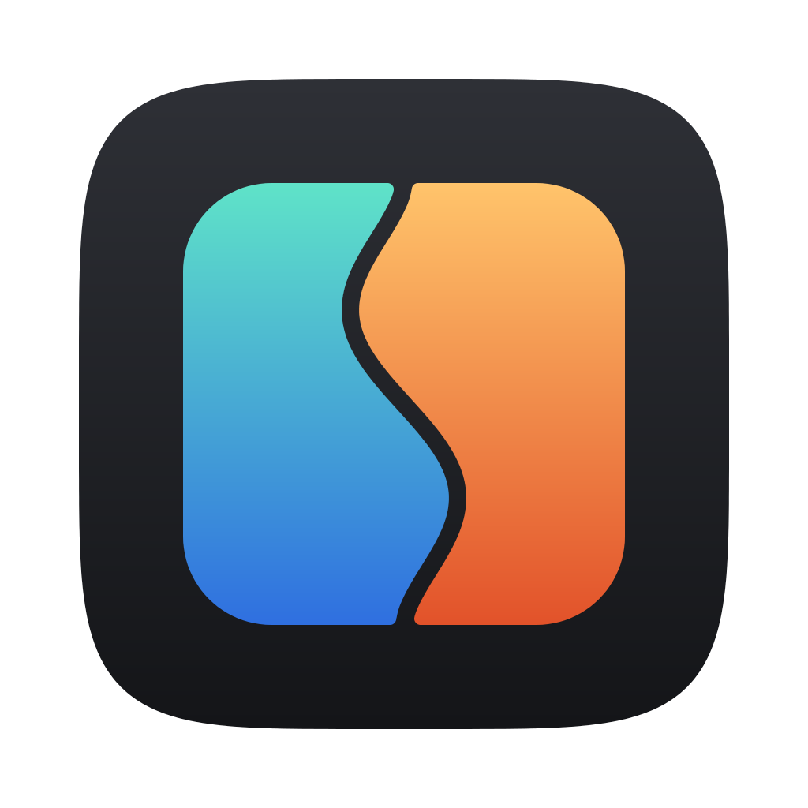

<h1 align="center">
  <br>
  GoldenOSX-VM
</h1>

<p align="center">
  <b>Run Apple Silicon macOS (macOS 27.2 / ARM64) in QEMU + KVM (Linux & WSL2) with real Metal vGPU rendering — even on 4–8 GB RAM laptops without an NVIDIA GPU.</b>
</p>

> [!NOTE]
> **GoldenOSX-VM** is a custom fork/modification of [Stela](https://github.com/tylertms/Stela) that adds a host-side **Metal-to-Vulkan vGPU daemon** (`stela-vgpu-daemon`), `ivshmem-plain` guest/host bridge (`VgpuGate`), **AIR→NIR disk shader caching**, **4 GB guest RAM support**, and full **QEMU + KVM / WSL2** compatibility.

## Highlights

- **Real Metal 3 / Apple7 vGPU over `ivshmem-plain`**:
  - Guest UEFI (`stela.efi` built with `--features soft-gpu`) forwards macOS `StelaGPU` / Metal operations over a 2 MiB `ivshmem-plain` shared-memory ring (`VgpuGate`) to `stela-vgpu-daemon` on the host.
  - Host daemon (`crates/stela-vgpu-daemon`) runs Stela's real `Service<NativeBackend, AirCompiler>` with zero-copy `VK_EXT_external_memory_host` mapping directly into QEMU's shared guest RAM (`/dev/shm/stela-guest-ram`).
- **Hardware Vulkan 1.3 + Automatic Lavapipe Fallback**:
  - `STELA_VK_BACKEND=auto` (default): probes `libvulkan.so.1` / `STELA_VK_ICD` for a hardware Vulkan 1.3 GPU first, and automatically falls back to statically linked **Mesa 26.2.5 Lavapipe (Vulkan 1.4 + LLVM 21)** on systems without a Vulkan 1.3 hardware GPU (e.g., WSL2 / Intel Skylake).
  - `STELA_VK_BACKEND=hardware`: forces external hardware Vulkan with no fallback.
  - `STELA_VK_BACKEND=lavapipe`: uses built-in Lavapipe directly.
- **Persistent AIR→NIR Disk Shader Cache (`.stela-nir-cache/`)**:
  - Serializes compiled `nir_shader` objects via Mesa's `nir_serialize()` / `nir_deserialize()`, turning 250+ Metal shader compilations on subsequent boots into `< 1ms` cache hits.
- **Verified End-to-End on macOS 27.2 (Build 26B123)**:
  - Boots to Lock Screen, Liquid Glass compositor, Setup Assistant, and full **macOS Desktop (Dock, Finder, Keyboard Setup Assistant)** on an Intel Core i5-6287U (2 cores / 8 GB RAM) inside WSL2!

## Key Modifications over Upstream Stela

| Component | Change |
|---|---|
| `crates/stela-contracts/src/vgpu.rs` | Shared-memory wire protocol (`VgpuShmHeader`, `OP_*`, `WireRange`) for `ivshmem-plain` vGPU transport. |
| `crates/stela-boot/src/engine/gpu/vgpu_gate.rs` | UEFI-side `VgpuGate` bridging guest Metal calls and `IRQ 1152` completion interrupts over `ivshmem`. |
| `crates/stela-vgpu-daemon/` | Host Linux vGPU daemon (`NativeBackend` + `AirCompiler`), `HostPtrExporter` for QEMU Q35 4 GiB RAM layout, `STELA_VK_BACKEND` loader, and `nir_serialize` disk cache (`lvp_bridge.c`). |
| `crates/stela-driver-gpu/src/metal/` | `linear_in_place` capability flag (routing linear IOSurface textures through `aligned_copy` when `VK_EXT_image_drm_format_modifier` is absent), `HOST_ALLOCATION_EXT` import for Lavapipe, 384 MiB Lavapipe VRAM cap, and LLVM 21 compatibility in `air_to_nir.c` / `air_metadata.c` / `air_constants.c` / `air_calls.c`. |
| `crates/stela-boot-core/src/host_memory.rs` | Allows booting with 4 GB guest RAM in QEMU/KVM VMs. |
| `run-qemu-stela.sh` | Automated launcher: resizes `/dev/shm` if needed, starts `stela-vgpu-daemon` with NIR + Mesa shader caches and CPU `taskset` pinning, and launches QEMU Q35 + KVM + OVMF + `virtio-vga` + `ivshmem-plain`. |

## Quick Start (QEMU + KVM / WSL2)

```bash
# 1. Build the host vGPU daemon (after building Mesa 26.2.5 + libstela_metal_compiler.a)
cd crates/stela-vgpu-daemon
CARGO_BUILD_JOBS=2 cargo build --release

# 2. Build stela.efi with soft-gpu / VgpuGate support (release)
cd ../..
CARGO_BUILD_JOBS=2 cargo build --manifest-path crates/stela-boot/Cargo.toml \
  --target x86_64-unknown-uefi --release --features soft-gpu

# 3. Launch macOS 27.2 VM
./run-qemu-stela.sh
```

Environment variables supported by `run-qemu-stela.sh`:
- `STELA_VK_BACKEND=auto|hardware|lavapipe` (default: `auto`)
- `STELA_VK_ICD=/path/to/libvulkan_*.so` (optional custom Vulkan ICD)
- `STELA_XRES` / `STELA_YRES` (default: `1024` x `768`)

---

## Upstream Stela

A translation-based Apple Silicon layer for x86-64 PCs. It is a UEFI boot
program with an arm64-to-x86-64 translator, a Metal driver for NVIDIA GPUs and
a model of Apple silicon hardware. Stela currently presents itself as an M2 Mac mini.

> [!WARNING]
Stela is still in development. It is slow and still may not boot on supported hardware. Fixes are on the way, please submit a GitHub Issue with your boot logs if you encounter an error!

## Translator

An ahead-of-time and just-in-time compiler translates arm64e code to x86-64.
It covers more than 3,000 AArch64 instruction encodings, maps guest registers
to host registers and caches translated code.

## NVIDIA driver

The Metal driver compiles AIR, Metal's shader IR, directly to NIR, Mesa's IR,
and supports the Metal3 and Apple7 GPU families.

## Hardware requirements

| Part | Requirement |
|---|---|
| CPU | Intel or AMD x86-64-v2 (Intel Nehalem, AMD Bulldozer or newer). AVX2 and AVX-512 are used when present. |
| Memory | 8 GB or more. |
| Firmware | 64-bit UEFI with Secure Boot off. |
| GPU | NVIDIA GeForce GTX 16 or RTX 20, 30, 40 or 50 series. |
| Disk | NVMe, or SATA in AHCI mode. 60 GB or more for macOS: a GPT partition or a whole disk to erase. |
| USB stick | 8 GB for the Online installer, 32 GB for the Offline installer. |
| Ethernet | Intel I225, I226, I210, I211, I350, 82574L, 82575, 82576, 82579, 82580, I217, I218, I219.<br>Realtek RTL8111, RTL8168, RTL8169, RTL8411, RTL8125, RTL8126, Killer E2600, E3000.<br>Broadcom BCM5720, BCM5761, BCM5762.<br>Aquantia AQC100, AQC107, AQC108, AQC109, AQC111, AQC112, AQC113, AQC114, AQC115C, AQC116C.<br>Qualcomm Atheros AR8131, AR8132, AR8151, AR8152, AR8161, AR8162, AR8171, AR8172, Killer E2200, E2400, E2500.<br>USB: Realtek RTL8152, RTL8153, RTL8156, ASIX AX88179, AX88178A, AX88772, CDC ECM and NCM. |
| Wi-Fi | None currently supported. |
| Bluetooth | None currently supported. |
| Audio | None currently supported. |
| USB | xHCI (USB 3) and EHCI controllers, hubs, USB disks. |
| Input | USB keyboards and mice. PS/2 keyboards, mice and Synaptics or Elantech touchpads. |

## Install

1. Download `stela` from the
   [releases page](https://github.com/tylertms/Stela/releases).
2. Run `sudo ./stela` (Linux, macOS) or double-click `stela.exe`
   (Windows).
3. Choose the USB stick and the installer, then confirm. This erases the USB
   stick.
4. Boot the PC from the USB stick.

## Update

Download the new `stela`, plug the USB stick in and run:

```sh
sudo ./stela update
```

On Windows, open Terminal with Run as administrator and run:

```
.\stela.exe update
```

## Logs

If Stela does not work, plug the USB stick into any computer with `stela` and
save the boot log. Include `log.txt` in your GitHub Issue. Save it before you
start Stela again many times: the log keeps the start of each of the last
eight boots, but only the latest part of a long run.

```sh
sudo ./stela log --output log.txt
```

On Windows, open Terminal with Run as administrator and run:

```
.\stela.exe log --output log.txt
```

## Build

You need [Rust](https://rustup.rs), git, Python 3.10 or newer, and LLVM 21,
22 or 23 with Clang, LLD and libclang. On macOS, Xcode's Apple clang 21 or
newer also works.

```sh
git clone https://github.com/tylertms/Stela
cd Stela
cargo xtask dist
```

This writes `target/release/stela`. The first build fetches and compiles
Linux, Mesa and LLVM sources and takes a long time.

## Legal

Stela contains no Apple software. You are responsible for following Apple's
software license agreement and terms of use.

Stela's code is GPL-2.0-or-later. See [LICENSE](LICENSE) and [NOTICE](NOTICE).

## Community

[Discord Server](https://discord.gg/aSkwrJEMYc)
